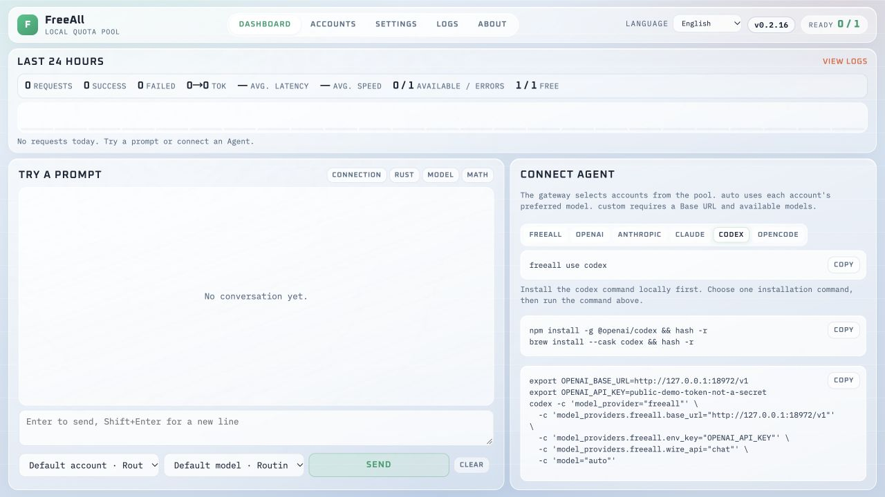
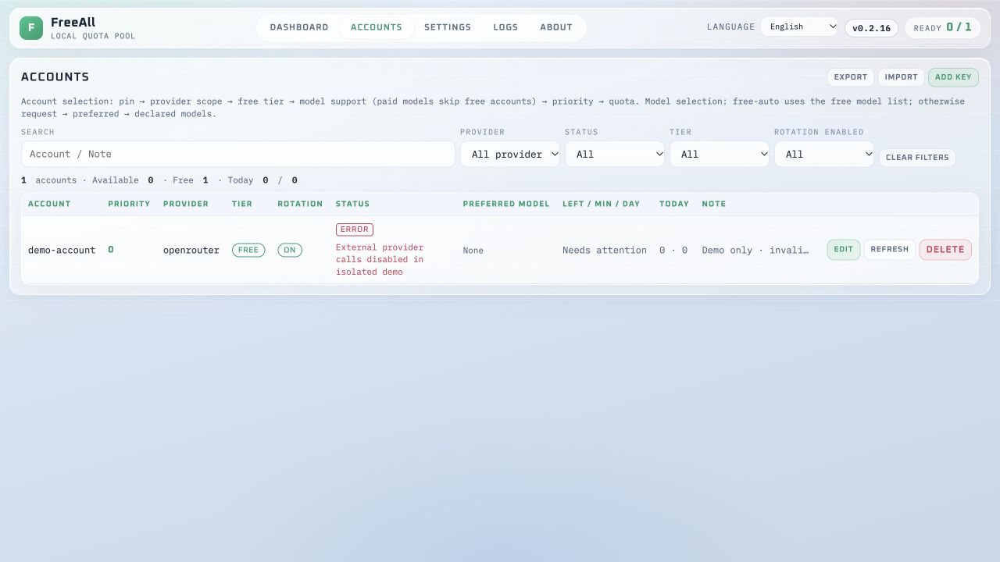
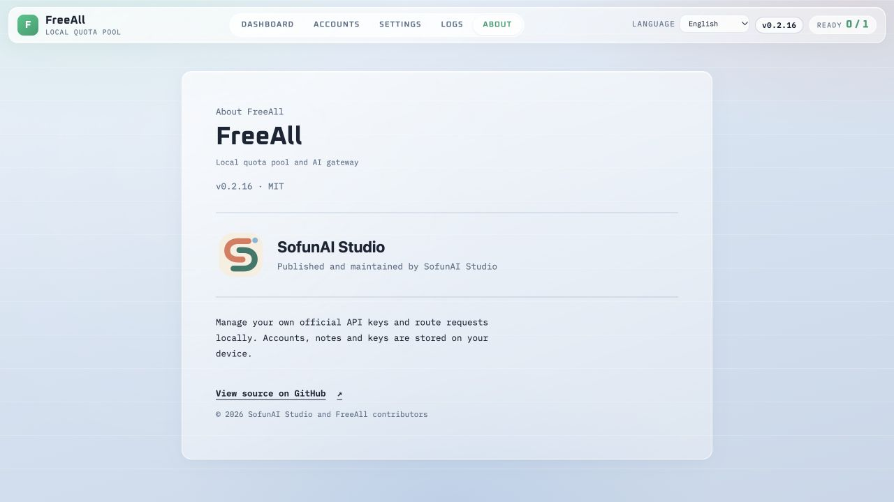

# FreeAll · Screenshots and walkthrough / 界面与演示

**v0.2.16 · 2026-10-22**

[Watch / 下载 MP4](https://github.com/KyleZheng8848/freeall/releases/download/v0.2.16/freeall-browser-walkthrough-0.2.16.mp4)

Real panel, isolated temporary store, invalid example API key and public placeholder gateway token. External provider calls are disabled; the error state is expected. No successful model response, usage or quota is invented. This silent, bilingual video contains edited sampled browser captures: language selection, account form, account pool, agent setup commands and About. It does not demonstrate native menus or a real provider request.

真实面板、隔离临时数据、无效示例 Key 和公开占位网关 token。外部调用已禁用，账号错误状态符合预期；没有虚构成功回复、调用量或可用额度。视频带双语字幕、无旁白，使用采样浏览器画面剪辑，覆盖语言、账号添加、账号池、Agent 接入与关于页；不代表原生菜单操作或真实供应商调用。
